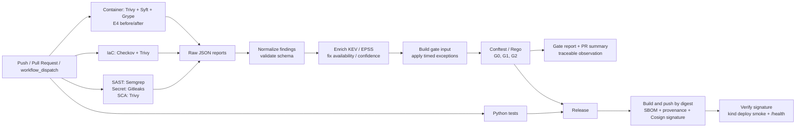

# Đề tài 21 – DevSecOps

**Tên đề tài:** Xây dựng đường ống DevSecOps phát hiện cấu hình sai và lỗ hổng trước triển khai

## Giới thiệu

Đề tài xây dựng một pipeline DevSecOps trên GitHub Actions nhằm phát hiện cấu hình sai và lỗ hổng trước khi triển khai.

Pipeline gồm 5 lớp kiểm tra:

- SAST
- Secret scanning
- SCA
- IaC scanning
- Container image scanning

Kết quả từ các công cụ được chuẩn hóa và đưa vào Security Gate. Gate quyết định `BLOCK`, `WARN` hoặc `INFO` theo các chính sách G0, G1 và G2.

## Công cụ

| Thành phần | Công cụ |
| --- | --- |
| CI/CD | GitHub Actions |
| SAST | Semgrep |
| Secret scanning | Gitleaks |
| SCA | Trivy, Grype |
| IaC scanning | Checkov, Trivy |
| Container image | Trivy, Syft, Grype |
| Policy | Conftest / Rego |
| Image signing | Cosign |
| Deploy test | kind |

## Thực nghiệm

Bộ dữ liệu thực nghiệm gồm:

- 28 lỗi gieo cài
- 8 mẫu đối chứng
- 10 thay đổi sạch

Các thực nghiệm:

- **E1:** Đánh giá khả năng phát hiện
- **E2:** So sánh chính sách G0, G1 và G2
- **E3:** Đánh giá thời gian pipeline
- **E4:** Đánh giá ảnh hưởng của việc khắc phục đến image và SBOM

**Số liệu đã phân tích của run lịch sử #13:** Run baseline trên commit
`cbcef8e32d5b007229be5e424409e8ee00fe278e` đã thành công, gồm test, gate,
release, xác minh chữ ký và deploy smoke; đã lưu artifact `report-scan`,
`report-iac`, `report-image`, `report-gate` và `sbom` ([GitHub Actions run](https://github.com/gialong611/DevSecOps_Project/actions/runs/41288998886)).
Gate trả `WARN` với 275 findings, 0 blockers và 30 warnings (15 HIGH, 15 MEDIUM).
Ngưỡng hơn 20 warnings được đặt cho một PR; run này là `push`, nên chưa đo trực
tiếp độ nhiễu PR nhưng cho thấy baseline vượt ngân sách cảnh báo. Raw reports đã
được phân tích để lập danh sách package cần vá. Gate report/PR summary đã được cải tiến
để nối cảnh báo CVE/GHSA về finding nguồn, package, phiên bản đang cài, phiên bản
vá và vị trí; severity hiển thị theo policy thay vì gán mọi cảnh báo thành MEDIUM.
Thay đổi này làm cảnh báo có thể triage được nhưng chưa làm giảm số cảnh báo;
cần một CI run mới để ghi nhận tỷ lệ liên kết thực tế.
Raw artifact E4 cho thấy Trivy giảm từ 4.721 xuống 188 bản ghi lỗ hổng
(-4.533): CRITICAL 21→0, HIGH 531→52, MEDIUM 2.037→71, LOW 2.030→64,
UNKNOWN 102→1. SBOM giảm từ 22.921 xuống 2.860 thành phần (-20.061). Hai lần
quét dùng Trivy 0.76.1 và runtime ghi một DB snapshot ở cấp image job
`2026-11-01 07:08:40 UTC`; chưa có metadata riêng trước/sau từng lần quét.
Image local IDs đã trích được nhưng `RepoDigests` rỗng. Lượt E4 này dùng Python 3.12.15
ở image trước và 3.12.16 ở image sau, nên delta là quan sát có thật nhưng chưa
thể quy riêng cho các kiểm soát Dockerfile. Các cảnh báo MEDIUM được truy về package:
5 Python, 5 pip, 2 pytest và 3 Starlette. Sau run #13, working tree nâng Python
lên 3.13.18, pip lên 26.3, pytest lên 9.0.3, FastAPI lên 0.162.7 và Starlette
lên 1.10.0; image runtime đã bỏ pip và nâng ngưỡng bảo mật APT/zlib. Bản image
local mới nhất qua 64/64 pytest; Trivy không còn ba CVE gây BLOCK trong log mới
nhất và không tìm thấy HIGH/CRITICAL có bản vá. Đây là xác nhận cục bộ, chưa phải
kết quả CI; số warning của workflow chỉ được chốt sau một run mới. Checkov raw
trong artifact là stream 3 JSON document: loader của dự án đọc được, còn
`json.load` báo `Extra data` ở dòng 6354. Workflow local đã đổi để giữ
`checkov.stream.json` và xuất `checkov.json` dạng array; chờ run
mới xác nhận. Chưa đủ để kết luận recall, false-positive rate hoặc thời gian
đại diện vì chưa có đủ fixture D/C/N. Một observation truy vết
được ghi thời gian ba job scan là 28s (security-scan), 37s (IaC) và 171s
(image); 171s là đường găng của giai đoạn
scan song song trong một run, không phải tổng thời gian workflow. Các CSV/biểu
đồ đang commit vẫn là dữ liệu thiết kế/thăm dò, không thay cho quan sát scanner
thô theo fixture. Bản đồ cảnh báo và metric E4
đã được lưu tại `Code/DevSecOps/tests/results/metrics/`. Quy trình
thu thập và tổng hợp: `Code/DevSecOps/tests/README.md`.
Xem bảng tự đánh giá và việc còn thiếu tại `PROJECT_COMPLETION.md`.

### Trạng thái bằng chứng hiện tại

- Artifact mới nhất đã đọc là [run #43572212518](https://github.com/gialong611/DevSecOps_Project/actions/runs/43572212518/attempts/1), commit `852196ca45ad7275cccd6cbdc6f05de2dc2a4a93`, `push` trên `main`, fixture `baseline`.
- Gate của run này trả `WARN` nhưng pass: **296 finding chuẩn hóa, 0 blocker, 19 warning**. Có 17 cảnh báo HIGH chưa có bản vá và 2 MEDIUM có bản vá; 19/19 warning được liên kết tới finding nguồn. Đây không phải kết quả của log fail có 3 blocker đã gửi trước đó.
- Run chỉ đo baseline cold một lần: security-scan 25 giây, IaC 52 giây, image 87 giây; đường găng scan song song 87 giây, tổng runner 2,733 phút. E4 không được yêu cầu; run là `push`, không chứng minh PR block/pass.
- Artifact `report-iac` có 16 cấu hình Trivy trạng thái `FAIL` (3 CRITICAL, 2 HIGH, 6 MEDIUM, 5 LOW), nhưng normalizer cũ chỉ nhận trạng thái `FAILED`, nên các mục này bị bỏ khỏi gate. Working tree hiện đã nhận cả hai cách viết; Trivy quét IaC lại sau khi siết egress còn 11 mục và không còn `AWS-0104`. Cần CI mới để xác nhận gate sau sửa.
- Hai SBOM đều có 2.856 thành phần giống nhau; SBOM phát hành ghi digest GHCR, còn SBOM của image scan gắn tag cục bộ. Nên nối báo cáo quét với digest phát hành trong lần cải thiện tiếp theo.
- Các thư mục run #13 và #14 bên dưới là bằng chứng lịch sử; không dùng chúng thay cho run #435722 hoặc các lượt lặp thực nghiệm.
- Các số 275 findings, 30 warnings, delta image/SBOM và một lượt timing ở trên
  thuộc run #13; chúng là dữ liệu lịch sử, không phải kết quả đo hiện tại hay
  nhiều lần lặp.
- E1/E2 từ `decisions.csv`, E3 từ `runs.csv` và E4 T0 KEV/EPSS vẫn mang nhãn
  exploratory/simulation. Chúng không được dùng để khẳng định scanner recall,
  false-positive rate hoặc hiệu quả cache ngoài dữ liệu quan sát CI.
- Workflow và script đang được hoàn thiện để thu thập từng fixture D01–D28,
  C01–C10, N01–N08, đo E3 cold/warm lặp lại, và kiểm tra E4 bằng cùng DB
  snapshot. Các thay đổi parser, policy và egress hiện tại chưa được xác nhận bởi GitHub Actions.
- Sau khi có artifact mới và số liệu được kiểm tra, cập nhật DOCX. PPTX được giữ
  nguyên theo phạm vi đã thống nhất.

Để thu thập dữ liệu sau khi workflow/code mới được đẩy lên GitHub, xem hướng dẫn
ở `Code/DevSecOps/tests/README.md`. GitHub Actions không thể được dispatch từ
môi trường làm việc hiện tại.

## Kiến trúc pipeline



Job quét chạy song song; gate tổng hợp báo cáo scan, IaC và image. `BLOCK` làm
job gate thất bại; `WARN` vẫn cho job tiếp tục và được ghi vào báo cáo. Release
chạy sau khi unit test và gate job thành công; deploy smoke xác minh chữ ký
trước khi triển khai thử trên `kind`. Workflow và quyền từng job được khai báo
tại `.github/workflows/ci.yml`.

## Cấu trúc repository

```text
DevSecOps_Project/
├── .github/            CODEOWNERS, pull_request_template.md, workflows/ci.yml
├── Code/DevSecOps/     (+ pytest.ini, Dockerfile, .dockerignore khi có)
│   ├── src/            app FastAPI: app/, test/, requirements.txt
│   ├── infra/  deploy/ Terraform (chỉ quét); manifest Kubernetes
│   ├── lab/            docker/Dockerfile.vuln (E4); workflows-vuln/ (mẫu để gieo D26–D28 bằng patch)
│   ├── rules/          semgrep/, conftest/: luật PHÁT HIỆN lỗi (đầu vào của máy quét)
│   ├── tools/  schemas/   script, tools/test/ (fixture); findings, exception, severity_map
│   ├── policy/         g0/ g1/ g2/: luật QUYẾT ĐỊNH chặn của gate
│   ├── security/  ground_truth/   exceptions.yaml, kev/; ground_truth.csv, patches/
│   └── tests/          script thí nghiệm, analysis.ipynb; results/{raw,metrics,triage}/ và runs, findings, decisions .csv
├── DOCX/  PPTX/  Extra/
└── README.md  requirements.txt  .gitignore  .gitattributes  (+ .gitleaks.toml khi có)
```

## Tài liệu

- Báo cáo: `DOCX/bao_cao_do_an_DevSecOps.docx` (sinh lại bằng `python Extra/build_report_docs.py`; mặc định chỉ cập nhật DOCX)
- Slide: `PPTX/slide_thuyet_trinh_DevSecOps.pptx` (chỉ sinh lại khi gọi script với `--with-pptx`)
- Phiên bản công cụ và SHA action: `Extra/TOOL_VERSIONS.md`
- Tài liệu chính sách gate: `Code/DevSecOps/policy/README.md`
- Tài liệu bộ đáp án và ánh xạ CWE/CVE: `Code/DevSecOps/ground_truth/README.md`
- Tài liệu tham khảo và phạm vi CSA CCM/CIS/SLSA: `Code/DevSecOps/REFERENCES.md`
- Phân tích số liệu: `Code/DevSecOps/tests/analysis.ipynb`

## Kiểm nghiệm

```powershell
# Luật gate Rego (G0, G1, G2) và luật phát hiện workflow
powershell -ExecutionPolicy Bypass -File Code/DevSecOps/tests/run_policy_tests.ps1
conftest verify -p Code/DevSecOps/rules/conftest

# Unit test ứng dụng (chạy cùng lệnh trong CI)
python -m pytest -v Code/DevSecOps/src/test Code/DevSecOps/tests

# Thí nghiệm E1, E2, E3, E4
python Code/DevSecOps/tests/e1_detection_effectiveness.py --policy g0
python Code/DevSecOps/tests/e1_detection_effectiveness.py --policy g1
python Code/DevSecOps/tests/e1_detection_effectiveness.py --policy g2
python Code/DevSecOps/tests/e2_policy_comparison.py
python Code/DevSecOps/tests/e3_pipeline_duration.py
python Code/DevSecOps/tests/e4_image_remediation.py
```
